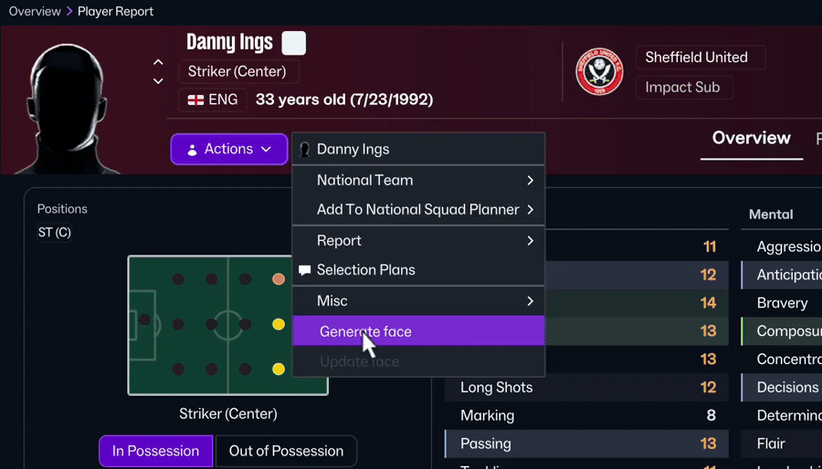

# RegenerateFM

RegenerateFM makes new portraits for Football Manager players and staff who don't have one, and updates the faces they already have. You choose **Generate new face** or **Update face** from the person's portrait menu in the game. The face is created from their profile and appears in the game a few seconds later. A whole squad or a club's whole staff can be done in one go.

*Recorded in FM26 on a Mac. Each request takes about 20 seconds; the wait is shortened here.*

Regen face packs give a player a stock photo picked from thousands by nationality or ethnicity. RegenerateFM paints a portrait of that particular person from what the game knows about them:

- **Faces that match the attributes.** The prompt includes the player's age, position, height, known physical attributes (Strength, Pace, Stamina and so on) and their best and weakest technical and mental attributes, plus the headline of their biography when there is one. So a 6'4" centre-back with 18 Strength is drawn as one, and a slight, quick 17-year-old winger looks nothing like the centre-back. Attributes hidden by scouting are left out rather than guessed.
- **Real players look like themselves (FM26).** For a real player or staff member, rather than a newgen, the prompt asks for their own likeness instead of using attributes and traits, plus FM's ethnicity once you've watched them play a match. In a test of 100 well-known players, this got their ethnicity right more often than a guess from their name, with no random traits to throw it off.
- **In their club's kit.** Players wear their current club's home kit and colours, goalkeepers the club's goalkeeper kit, free agents a plain shirt, and staff a plain dark jacket or training top. No badges, sponsors or numbers are drawn.
- **Update face keeps up with your save.** A face pack photo never changes during a save. **Update face** takes the face the person already has (a RegenerateFM portrait or the game's own photo) and redraws the same person at their current age, in their current club's kit. Use it after a transfer, or a few seasons on, to age a regen you've watched grow up. Their face shape, features, skin tone, eyes, hair and marks stay the same; only the natural signs of age and the kit change. On FM26's own 3D face for a newgen, Update face turns the render into a photograph of the same lad, keeping his skin tone, eyes and hair.
- **The same person every time.** A person's face shape, features and hairstyle are chosen once from their game ID and kept, so generating a face again gives a fresh picture of the same-looking person, not someone new.

- **Football Manager 26** (26.3.2, and the FM26 Demo) through a BepInEx plugin.
- **Football Manager 2024** (24.4.2) through a small DLL and a companion program.

The images come from OpenAI's image API, and each face is one paid image request. You pay for them in one of two ways (see [Choose how to pay](#1-choose-how-to-pay)): **RegenerateFM credits**, bought with your email and a card, with no OpenAI account needed, or **your own OpenAI API key**, which is cheaper per face but needs an OpenAI API account with billing. The mod itself is free. RegenerateFM is independent of Sports Interactive, SEGA and the BepInEx project.

| | Windows | Linux (Steam/Proton) | macOS (Apple Silicon) |
|---|---|---|---|
| **FM26** 26.3.2 | Supported | Supported | Supported (runs under Rosetta 2) |
| **FM26 Demo** 26.3.2 | Supported | Supported | Supported (runs under Rosetta 2) |
| **FM24** 24.4.2 | Supported | Supported | Supported |

Each supported combination has been checked in game; see [Platform support](#platform-support). RegenerateFM is pinned to these builds and turns itself off on any other version until it is checked.

## 1. Choose how to pay

Each generated or updated face is one image request to OpenAI, so each one costs a little. The first time you choose a face command, the game's key dialog offers both ways to pay, in FM26 and FM24. You can change your mind later.

Previews (`--preview-only` for FM24) and imports of existing PNGs make no request and cost nothing, whichever you use.

### RegenerateFM credits

One credit makes or updates one face. Packs go from 75 credits for £2 / €2.50 / $2.50 to 1000 for £20 / €24 / $24; prices include VAT or other sales tax, except in the US and Canada, where sales tax is added at checkout. If an image fails, the credit is given back.

1. In the game's key dialog, choose **Buy credits / Sign in**. Your browser opens the credits page at [credits.regenerate.fm](https://credits.regenerate.fm/link).
2. Enter your email and open the sign-in link RegenerateFM sends you, on the same computer. There's no password.
3. The page shows the code the game is showing: choose **Connect the game**, then choose a pack. Payment is by card through Stripe.
4. Back in the game, you're signed in and the face you chose carries on. There's nothing to paste.

To check your balance or buy more, sign in at [credits.regenerate.fm](https://credits.regenerate.fm/link); when your credits run out, the game's key dialog opens again. Your sign-in is saved where an OpenAI key would be (see below), so FM26 and FM24 on the same computer share it.

### Your own OpenAI API key

You need an OpenAI **API** account. A ChatGPT subscription (Plus, Pro and so on) is billed separately and doesn't give API access.

1. Sign up or log in at [platform.openai.com](https://platform.openai.com/).
2. Add credit. Go to **Settings > Billing**, add a payment method and buy some credit; a few dollars is enough to start. If you leave **auto recharge** off, OpenAI can never charge more than the credit you bought.
3. Verify your organisation if asked. OpenAI may require **Settings > Organization > General > Verify Organization** before its image models work. Without it, the first face fails with an error saying your organisation must be verified. Verification can take a few minutes to apply after it's done.
4. Create the key. Open [API keys](https://platform.openai.com/api-keys) and choose **Create new secret key**. Copy it now: OpenAI shows it only once. It starts with `sk-`.
5. In the game's key dialog, paste or type the key and choose **Save key**.

Treat the key like a password. Anyone who has it can spend your credit. RegenerateFM keeps it only on your computer and sends it only to OpenAI. Each face is typically a few cents or less at the default `medium` quality, and `low` quality is cheaper (see [Settings](#settings)). Check the [Usage](https://platform.openai.com/usage) page after your first few faces to see your real cost.

## 2. Set up FM26

The plugin makes the image requests itself from inside FM26, so nothing else needs to run while you play. Setup is copying one folder; on Linux and macOS an installer does it.

1. **Copy the files.** Close FM26. Find its game folder (in Steam: right-click Football Manager 26 > **Manage > Browse local files**). Copy everything inside the release ZIP's `FM26` folder into it. The FM26 Demo works the same way, in its own `Football Manager 26 Demo` folder. That adds [BepInEx 6.0.0-be.760](https://builds.bepinex.dev/projects/bepinex_be/), the mod loader, and the RegenerateFM plugin. If you already use BepInEx for other mods, copy only `BepInEx/plugins/RegenerateFM`.
2. **Linux by hand only:** set FM26's Steam launch option to `WINEDLLOVERRIDES="winhttp=n,b" %command%` (the FM26 Demo's too).

   **Linux:** use the installer instead of steps 1 and 2, for FM26, the FM26 Demo and FM24 at once. Unpack the release ZIP anywhere, close the games, quit Steam (**Steam > Exit**, not just closing its window) and run `./install-linux.sh` in the unpacked folder. It needs nothing else installed. For each game it finds in your Steam libraries, it copies the files and sets the Steam launch option; name one to do only that game (`./install-linux.sh fm26`, `fm26demo` or `fm24`, with `--game-dir "<folder>"` if Steam doesn't know it). Run it again after an update. `./install-linux.sh --remove` uninstalls and clears the launch options. It refuses while Steam is running, because Steam overwrites launch options changed while it's open.

   **macOS:** use the installer instead of steps 1 and 2. Open `RegenerateFM-macOS.dmg` from the release and run **RegenerateFM Installer**. It finds FM26 (and the Demo) in your Steam libraries, or you choose the game folder, and **Install** copies the files beside `fm.app` and sets FM26's Steam launch option, so Play in Steam starts RegenerateFM. Steam must be closed for the launch option: if it's running, the installer copies the files and asks you to quit Steam and click Install again (or shows the launch option to set yourself). **Update** installs a newer release the same way, and **Uninstall** removes it and clears the launch option; your faces are kept. FM26 then runs under Rosetta 2 (BepInEx's macOS runtime is Intel-only); the installer offers to install Rosetta if it's missing. `fm.app` itself is never changed. Without the installer, copy the contents of the installer's `FM26-macOS` folder (**RegenerateFM Installer.app > Show Package Contents > Contents/Resources**) beside `fm.app` and set the launch option yourself: the path of `run_regeneratefm.sh` in that folder, in quotes, followed by `%command%`. See [macos/README.md](macos/README.md).
3. **Start FM26.** The first start after installing takes a few minutes longer (up to about 10 on a slower computer) while BepInEx prepares the game, and nothing shows progress, so let it finish rather than closing it. **This happens once:** later starts are as quick as before, until an FM26 update, after which it happens once more. For that it needs Unity's libraries from BepInEx's site, unity.bepinex.dev; the Linux and macOS installers download them when they install, and otherwise BepInEx does on that first start. If the site doesn't answer, FM26 starts without RegenerateFM's commands and `BepInEx/LogOutput.log` says "Failed to download Unity base libraries": start FM26 again later (on Linux or macOS, you can run the installer again instead).
4. **Choose how to pay, in the game.** The first time you choose **Generate new face** (or a squad's **Generate faces…**), RegenerateFM's key dialog opens.
   - **Buy credits / Sign in** opens the credits page in your browser (see [RegenerateFM credits](#regeneratefm-credits)). Once you've connected the game, it carries on with what you chose.
   - **Or use your own key:** paste or type it and choose **Save key**. RegenerateFM checks it with OpenAI using a free request, then carries on. The dialog has a button that opens OpenAI's API keys page.
   - **Where it's kept:** your key or credits sign-in is saved outside the game folder, in `%APPDATA%\RegenerateFM`, encrypted for your Windows user. Under Proton that is inside the game's Wine prefix. On macOS it is `~/Library/Application Support/RegenerateFM`, readable only by you.
   - **Changing it:** the dialog opens again if OpenAI rejects your key, your credits run out or your sign-in expires. To switch between credits and a key, or forget them, delete that folder.

**Removing it:** on Linux, run `./install-linux.sh --remove` with Steam closed. Otherwise delete `BepInEx`, `dotnet`, `winhttp.dll`, `doorstop_config.ini` and `.doorstop_version` from the game folder (or only `BepInEx/plugins/RegenerateFM` if other mods use BepInEx). On macOS, use the installer's **Uninstall**, or delete `BepInEx`, `dotnet`, `Data`, `libdoorstop.dylib`, `.doorstop_version`, `clear-exception-ports` and `run_regeneratefm.sh`, and clear the launch option in Steam (for Epic's FM26, use the installer, which also makes Epic start the game itself again). To build the plugin yourself, see [src/RegenerateFM.FM26/README.md](src/RegenerateFM.FM26/README.md).

### Use it in FM26

- **Generate new face:** open a player or staff **Overview**, left-click the portrait and choose **Generate new face**, or use **Actions > Generate face**. The new face loads automatically. Choosing it again replaces that RegenerateFM portrait; if generation fails, the old one stays. A player with half or more of their attributes hidden (shown as "-") needs scouting first, and RegenerateFM says so; with fewer hidden, the known ones are used (a range such as 11-14 counts as known).
- **Update face:** in the same menus. It refreshes the face the person already has (a RegenerateFM portrait, the game's own photo, or FM26's 3D face for a newgen, which becomes a photograph) at their current age, in their current club's kit. It is greyed out when the person has no face.
- **Squad:** open **Squad > Overview**, or a team's own page (**First Team**, a reserve or academy team; in the FM26 Demo, **Squad > First Team**), open the top **Squad** dropdown and choose **Generate faces…**. RegenerateFM counts the players with no portrait and asks before making any request. It then does one face at a time. **Stop after current face** ends the batch after the face in progress. Players who already have a portrait are never replaced. Players with half or more of their attributes unknown to your scouts are skipped, and the batch says how many.
- **Staff:** open a club's **All Staff** list (your own club's **Club > Staff**, then its **All Staff** tab; another club's **Staff** tile on its Club Site) and choose **Generate faces…** beside **Filter**. It works like the squad command. A name the list doesn't link to (an owner's, say) is skipped, and the batch names them.
- **Both at once:** the squad confirmation has a tick box, **Include the club's staff**; the staff confirmation has **Include the first team's players**. Ticking it opens the club's other list and counts its missing faces, so the total shown covers both before anything is requested. The batch does the list it starts on, then goes to the other one through the club's Club Site.
- **Biographies:** for a profile with a biography, visit its **Career** tab once before generating, then return to **Overview**. The biography's headline paragraph is then included.

Faces are saved in FM26's user-data folder, `Documents/Sports Interactive/Football Manager 26/graphics/regeneratefm` (the Demo's is `Football Manager 26 Demo`; on macOS, `~/Library/Application Support/Sports Interactive/Football Manager 26/graphics/regeneratefm`). Errors appear in the portrait's tooltip and in `BepInEx/LogOutput.log`. The plugin turns its buttons off if FM26 updates to an untested build.

## 3. Set up FM24

FM24 needs a companion program that runs while you play; FM24 starts it and stops it for you. It reads the open profile from FM24's memory and makes the image requests. It also sets FM24 up the first time: a small DLL in the game folder that adds RegenerateFM's menu items, and an optional RegenerateFM skin built from FM24's own files.

**Windows**
1. Copy the release ZIP's `FM24` folder somewhere of your own, such as `Documents\RegenerateFM for FM24`, not into the game folder.
2. Close FM24 and double-click `regeneratefm-fm24.exe`. The first time, it finds FM24 through Steam, sets it up and asks in its window how you want to pay: **Buy credits / Sign in**, or paste your OpenAI key (checked for free). Either is saved encrypted in `%APPDATA%\RegenerateFM`, the same file the FM26 plugin uses.
3. Start FM24. Any skin works; to also get the menu on the portrait, choose the **RegenerateFM** skin in **Preferences > Interface**.
4. That's all: from now on FM24 starts RegenerateFM by itself and stops it when you quit. Run `regeneratefm-fm24.exe` again only after a RegenerateFM update or if you move its folder.

It needs nothing else installed: it's one self-contained program. It sets up every FM24 it finds, in your Steam libraries and where the Epic Games Launcher installed it, so Play in Steam and Launch in Epic both start RegenerateFM; Epic's FM24 is the same game packed slightly differently. If FM24 is elsewhere, run `regeneratefm-fm24.exe setup --game-dir "<path to the FM24 folder>"` from a command prompt. `regeneratefm-fm24.exe setup --remove` uninstalls the DLL.

**Linux (Steam/Proton)** uses the same `regeneratefm-fm24.exe`, which FM24 runs inside its Proton prefix. The release's `install-linux.sh` sets it up with FM26 (see [Set up FM26](#2-set-up-fm26)): it copies the companion to `~/.local/share/RegenerateFM/FM24`, so you can delete the unpacked release afterwards, installs the DLL and sets FM24's Steam launch option. `./install-linux.sh fm24` does only FM24. Start Steam and play: the first time, a small RegenerateFM window offers **Buy credits / Sign in**, or your OpenAI key (paste it with Ctrl+V). The full steps are in [src/RegenerateFM.Desktop/FM24/README.md](src/RegenerateFM.Desktop/FM24/README.md#the-companion-on-windows-and-linux).

**macOS (Apple Silicon)** uses the installer, as FM26 does: open `RegenerateFM-macOS.dmg`, run **RegenerateFM Installer** and choose Football Manager 2024. It copies the packaged companion into the game folder's `RegenerateFM` folder, installs `libregeneratefm24.dylib`, `run_regeneratefm24.sh` and the RegenerateFM skin, and sets FM24's Steam launch option (with Steam closed), so Play in Steam starts FM24 with RegenerateFM and the companion; nothing else needs installing. **FM24 from the Epic Games Store** is listed as "Football Manager 2024 (Epic)": with the Epic Games Launcher closed, Install makes `run_regeneratefm24.sh` the program Epic starts for it (Epic has no launch options), so Launch in Epic starts RegenerateFM. With both Steam's and Epic's FM24, Install sets up both; Uninstall removes it from the one chosen. Click Install again after an Epic update or Verify, which may undo that. The first time you choose a face command, FM24 asks in the game how you want to pay: credits or your OpenAI key. **Uninstall** in the installer removes it again. From source instead: build the Mac library with `python3 native/fm24/build_macos.py`, publish the companion and run its `setup` with FM24 closed; see [src/RegenerateFM.Desktop/FM24/README.md](src/RegenerateFM.Desktop/FM24/README.md). `fm.app` itself is never changed, and **Show screen IDs in Title Bar** isn't needed on the Mac.

In FM24, the profile's **Overview** tab menu has **Generate new face** and **Update face**, with any skin; with the RegenerateFM skin, so does a popup on the portrait. The Squad screen's **Overview** menu has **Generate missing squad faces…**, and the Staff screen's has **Generate missing staff faces…**; each can include the club's other people (its staff, or its players) in the same batch. Progress, confirmations and errors appear in FM24's own dialogs.

## Settings

Both games ask for your key or credits sign-in in the game (see above) and keep it in RegenerateFM's folder: `%APPDATA%\RegenerateFM` on Windows (inside each game's Proton prefix on Linux), `~/Library/Application Support/RegenerateFM` on macOS. The other settings are in `settings.ini` in the same folder, which RegenerateFM writes, with what each setting does, the first time it makes a face. It is reread before every request, so a change applies without restarting the game. On one computer FM26 and FM24 share it, as they share the key.

| Setting | Meaning |
|---|---|
| `Model` (section `[OpenAI]`) | The image model. The default is `gpt-image-2.5-sunburst`. |
| `Quality` | `low`, `medium` (default), `high`, `xhigh`, `max` or `auto`. Higher quality costs more per face. With credits, only `low` and `medium` are accepted, at one credit a face either way. |
| `ApiBaseUrl` | Leave as `https://api.openai.com/v1`; for testing only (an `https` address, or `http` on this computer). |
| `ServiceUrl` (section `[Credits]`) | Leave as `https://credits.regenerate.fm`; for testing only. |

## How faces are made

- **Player prompts** use the player's name, age, nationality, position, club, height, all eight physical attributes, and their three strongest and three weakest other attributes.
- **Staff prompts** use name, age, nationality, job title and club.
- **Real people (FM26):** Generate face for anyone who isn't one of FM's newgens asks for that person's own likeness, from their name, age, nationality, position or job title and club, with no attributes or appearance traits. OpenAI may refuse the most famous names (Lionel Messi was refused, and nothing is saved).
- **Ethnicity (FM26):** RegenerateFM saves the ethnicity, skin tone and hair colour that FM uses when it draws people in a 3D match, and a newgen's from their FM appearance, under `.regeneratefm-ethnicities.json` in the graphics folder, and adds it to the prompt. When a newgen's isn't known, Generate face asks first: the AI guesses it from their name and nationality, or you pick one.
- **Biography:** both kinds include the biography's headline paragraph when the game has shown it.
- **Appearance traits:** each newgen (and, in FM24, each person) gets five seeded appearance traits: facial proportions, features, hair, facial hair and expression. The hair colour is kept only for a white Northern European; otherwise the prompt uses FM's hair colour, or one natural for their ethnicity. They're saved by person ID under `.regeneratefm-appearances/` in the graphics folder and reused when you regenerate, so keep that folder when moving portraits. A new image can still change the face itself.
- **Size:** the API returns 1024×1024 images, which are scaled to FM's 256×256 portrait size.
- **Update face** sends the current face to OpenAI's image edit endpoint, which adds input-image cost to the request, and always asks for a realistic photograph. When the face is FM26's own 3D face for a newgen (its portrait address starts with `newgen_`) and RegenerateFM hasn't made one for them yet, the prompt instead turns the render into a real person: it keeps the skin tone, eye colour and hair, and gives the face the person's appearance traits, the same ones Generate face uses. OpenAI refuses to edit real photos of very famous people (Lionel Messi was refused, and nothing is saved). Lesser-known players' photos and generated faces work.

The FM26 plugin and the FM24 companion share one generator, [src/RegenerateFM.Core](src/RegenerateFM.Core). `tests/RegenerateFM.Tests` checks its prompts against `tests/RegenerateFM.Tests/Fixtures/expected-prompts.json`.

## Platform support

Everything has been tested on Linux with Steam/Proton. Status elsewhere:

| Part | Windows | macOS |
|---|---|---|
| FM26 plugin | Its native target: the build check pins the Windows game binaries that Proton also runs. On Windows 10, with FM26 26.3.2 and the FM26 Demo, the plugin loads and the portrait, Actions and squad commands work: billed single faces, Update face (on a RegenerateFM portrait and a game photo), staff faces, a biography, and squad batches with Stop (the Demo's returns to First Team between faces). On 2026-10-21, with the image stand-in: the scouting message for a player with half or more of their attributes hidden (after its 5 s check, closed by Escape or by leaving the page), a partly scouted player's face, and squad batches on First Team and a reserve team's page that skip players needing scouting and keep their result after Stop. On 2026-10-22 (1.0.0, copied from the release ZIP, with the image stand-in): the key dialog's credits option and saving a key, Aitana Bonmatí read as a woman, Jude Bellingham's face made from his brother Jobe's, batches on Barcelona's women's team (from its club page, returning with Back) and an 8-face Atlanta United first-team batch, and your own players' profiles opening as fast as without the plugin. | Through the `FM26-macOS` folder: BepInEx be.789 under Rosetta 2, with a rebuilt hooking library and a patched Il2CppInterop ([macos/README.md](macos/README.md)). On FM26 26.3.2 for Mac (2026-10-21): Generate and Update for players and staff (a staff face shows at once), the scouting message, squad batches on First Team and a reserve team's page, and a billed face. The FM26 Demo for Mac (2026-10-21, with the image stand-in): a 21-face First Team batch, and Generate and Update for a staff member, each shown at once. On 2026-10-26, with the image stand-in: Atlanta United's All Staff command (15 faces, the owner skipped), both tick boxes counting the other list, and a batch going from the first team to the staff list. |
| FM24 DLL | The same Windows DLL; Windows loads it from the game folder without a launch option. On Windows 10 with FM24 24.4.2: the profile Overview menu's Generate new face and Update face (greyed for a person with no face), and the Squad menu's Generate missing squad faces…. On 2026-10-21, with the image stand-in: the same command on another club's Players tab (Inter Miami, 10 faces) and a Development Center team (Atlanta United 2), and Stop. | A Mac library (`native/fm24/regeneratefm24_macos.c`) for FM24 24.4.2's Apple Silicon build, loaded by `run_regeneratefm24.sh`. On the Mac it adds the same menus and dialogs, reloads the skin, serves the companion's memory reads and starts the companion. Checked in game on 2026-10-21: profiles, staff, squad batches (the first team, a Development Centre team and another club's), and billed Generate and Update. |
| FM24 companion | A .NET program with a Windows memory reader (`ReadProcessMemory`, `VirtualQueryEx`), which also runs under Wine in the game's Proton prefix. On Linux (2026-10-25, under Proton): FM24 started and stopped it, its key window saved a key, and Generate new face, Update face from FM24's own photo (billed) and an Inter Miami II squad batch with Stop worked. **Its Windows run is not yet checked** (an earlier Python version's was: setup, squad batches and a billed face on Windows 10). | The same program built for the Mac, reading memory through the Mac library; FM24's launcher starts it. **Not yet checked on the Mac** (an earlier Python version's was: every player and staff member of a surveyed save read). |

## Release scope

- **FM26:** tested on 26.3.2 with the vanilla skin and BepInEx 6.0.0-be.760. FM ActionLink is no longer needed; the plugin also works beside it.
  - Its squad scanner matched all 49 players in the test save.
  - A three-face billed batch generated and reloaded every missing portrait; a fresh scan afterwards found none missing. That run used the earlier separate server; the plugin now makes the request itself.
  - Its game-binary checks disable the buttons on other FM26 builds.
- **Windows 10:** FM26 26.3.2 (a 23-player squad scan and a 10-face batch) and FM24 24.4.2 (a 28-player squad scan and a 9-face batch), each with one billed face; the other faces used a stand-in for the image API.
- **FM26 Demo:** tested on Windows 10 with the vanilla skin and the same BepInEx. Its squad pages differ from the full game's: Overview is a dashboard, so the squad command is on **First Team**, where the scanner matched all 33 players. On Linux (2026-10-21, with the image stand-in): BepInEx's first start, a First Team scan (8 of 33 missing) and an 8-face batch, and Update face for a player, each shown at once.
- **FM24:** tested on 24.4.2 with its vanilla-based skin through the native DLL: previews of every command, a billed single face and a billed squad batch with Stop.
- **Linux installer:** on 2026-10-25, the release's `./install-linux.sh` (now a self-contained program) refused while Steam ran, then set up FM26, the FM26 Demo and FM24: it kept FM24's DLL, token and skin, and copied the companion to `~/.local/share/RegenerateFM/FM24`. FM26 loaded the RegenerateFM plugin, and FM24 started the companion. Not yet checked on a Steam Deck or with Flatpak or Snap Steam.
- **Not yet checked:** other skins, resolutions, languages and game builds.

## Building from source

The code is in `src/`, built with the .NET 10 SDK (`global.json`):

- `src/RegenerateFM.Core`: the generator both games share (prompts, appearance traits, the image and credits requests, the key and `settings.ini`).
- `src/RegenerateFM.FM26`: the FM26 BepInEx plugin, which compiles Core's files into one `RegenerateFM.dll`.
- `src/RegenerateFM.Desktop`: everything outside the games. Built for Windows and macOS it is `regeneratefm-fm24`, the FM24 companion and its setup; built for Linux it is `regeneratefm`, the installer for every game.
- `native/fm24`: FM24's DLL and Mac library (C), which add its menus and talk to the companion.
- `macos`: the macOS installer app and the patched BepInEx parts it carries.
- `tools`: the release scripts. `tests/RegenerateFM.Tests` (`dotnet test`) and `tests/tools` (`python3 -m unittest discover -s tests/tools`) are the tests; neither makes a billed request.

To make a release ZIP, build the FM26 plugin ([src/RegenerateFM.FM26/README.md](src/RegenerateFM.FM26/README.md)) and FM24's DLL (`native/fm24/build.py`), then run `python3 tools/make_release.py`. It publishes the FM24 companion and the Linux installer with the .NET SDK, downloads the pinned BepInEx build once (checking its SHA-256), and writes `dist/RegenerateFM-Windows-Linux.zip` (Linux uses it too: both games run there under Proton). The ZIP holds `FM26` (BepInEx and the plugin, to copy into the game folder), `FM24` (the companion), `linux` (the installer `install-linux.sh` runs) and `source`. It refuses a program that names the computer it was built on, and leaves out keys, portraits and the translated third-party research guide. It can be made on Windows too: `.gitattributes` keeps text files' LF line endings there, so the shell scripts still run on Linux, and the files' modes come from git. RegenerateFM's own code and documentation are licensed under the [GNU GPL version 3 or later](LICENSE), with the additional permission and terms in [NOTICE.md](NOTICE.md); the bundled third-party software is listed in [licenses/THIRD_PARTY_NOTICES.md](licenses/THIRD_PARTY_NOTICES.md), and its licences are in `licenses/` (`licenses/fetch_licenses.py` refreshes them). Every GitHub release also carries `RegenerateFM-third-party-source.zip`, the source of the bundled GPL and LGPL software, made by `python3 tools/make_source_archive.py`.
